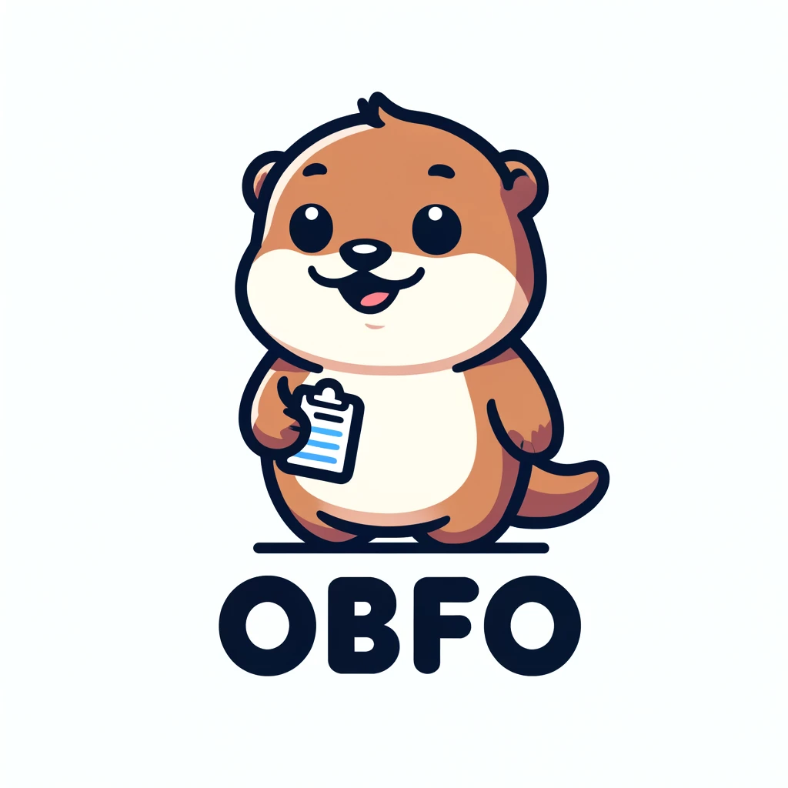

# obfo

[](https://www.npmjs.com/package/@johnhenry/obfo)
[](https://github.com/johnhenry/obfo/actions/workflows/ci.yml)
[](LICENSE)

Full documentation: [opensource.johnhenry.me/obfo](https://opensource.johnhenry.me/obfo/)



Convert HTML forms into nested JavaScript objects, and back. obfo (Object Form) reads the structure you mark up with a few `data-obfo-*` attributes: `{}` and `[]` containers become objects and arrays, inputs become values, and everything else (labels, headings, layout `div`s) is looked through. The same structure works in the other direction too: `fill` writes an object into a form, `observe` reports the form's object every time it is edited, and `formFromObject` builds a form for a JSON value.

Zero dependencies. ESM. Runs wherever there is a DOM: browsers, iframes (another realm), and Node with happy-dom or a similar DOM.

## Contents

- [Install](#install)
- [Quick start](#quick-start)
- [Reading a form: `obfo`](#reading-a-form-obfo)
- [Typed values: `cast: "auto"`](#typed-values-cast-auto)
- [Writing a form: `fill`](#writing-a-form-fill)
- [Live values: `observe`](#live-values-observe)
- [Generating a form: `formFromObject`](#generating-a-form-formfromobject)
- [TypeScript](#typescript)
- [Honest limitations](#honest-limitations)
- [Family](#family)
- [License](#license)

## Install

```sh
npm install @johnhenry/obfo
```

**Provenance:** previously published as [`obfo`](https://www.npmjs.com/package/obfo), last unscoped version 0.0.9 (2024-07-27). `@johnhenry/obfo` restarts at `0.0.0` under the family's convention for adopted packages, so the number means "new address", not "new code". Under npm's caret rules `^0.0.0` matches only `0.0.0`, so pin exactly until a deliberate `0.1.0`.

## Quick start

```html
<form id="fo" data-obfo-container="{}">
  <input name="first" value="Jon" />
  <input name="last" value="Doe" />
</form>
```

```javascript
import obfo from "@johnhenry/obfo";
const fo = document.getElementById("fo");
const ob = obfo(fo);
console.log(ob); // logs { first: "Jon", last: "Doe" }
```

The test suite runs every example in this README (`test/readme.test.mjs`) and checks it against its `// logs` comments; a Playwright suite runs the same features in Chromium, Firefox and WebKit.

## Reading a form: `obfo`

`obfo(element, options?)` reads `element` and returns its value. `element` is usually a form with `data-obfo-container`, but any element works: called on a single input, obfo returns that input's value.

To bridge the differences between an HTML form and a JavaScript object, obfo uses data attributes.

### `data-obfo-container`

Groups elements into an object (`{}`) or an array (`[]`).

An element is a "direct child" of a container when:

- it is an input (`input`, `textarea`, `select`), has `data-obfo-value`, or has its own `data-obfo-container`, and
- no other container sits between it and the container. Elements without any of these (`label`, `div`, `fieldset`, `h2`) are transparent: obfo looks through them at their children.

Buttons are ignored: `button` elements and `input` elements of type `submit`, `image`, `button` and `reset`. The one exception is the submitter you pass as `options.submit`, which is read like an input.

The root element needs `data-obfo-container` (or the `container` option, below). Without either, `obfo` returns `null`.

#### `data-obfo-container="{}"`

Direct children of an object container need a `name` or `data-obfo-name` attribute; obfo throws when one has neither.

```html
<form id="fo" data-obfo-container="{}">
  <input name="first" value="Jon" />
  <input name="last" value="Doe" />
</form>
```

```javascript
import obfo from "@johnhenry/obfo";
const fo = document.getElementById("fo");
console.log(obfo(fo)); // logs { first: "Jon", last: "Doe" }
```

When two children share a name, the last one wins (radio groups read with `cast: "auto"` are the exception; see [Typed values](#typed-values-cast-auto)).

#### `data-obfo-container="[]"`

Direct children of an array container are pushed in document order; their `name` and `data-obfo-name` attributes are ignored.

```html
<form id="fo" data-obfo-container="[]">
  <input name="first" value="Jon" />
  <input name="last" value="Doe" />
</form>
```

```javascript
import obfo from "@johnhenry/obfo";
const fo = document.getElementById("fo");
console.log(obfo(fo)); // logs ["Jon", "Doe"]
```

### `data-obfo-name`

The key for an element inside a `{}` container when it has no `name` attribute: a nested container, a `data-obfo-value` element, or an input you'd rather not give a `name`.

### `data-obfo-value`

Reads the text of a non-input element as a value. Use it with `data-obfo-name` where a key is required.

```html
<form id="fo" data-obfo-container="{}">
  <p data-obfo-value data-obfo-name="note">Call after five</p>
</form>
```

```javascript
import obfo from "@johnhenry/obfo";
const fo = document.getElementById("fo");
console.log(obfo(fo)); // logs { note: "Call after five" }
```

### `data-obfo-cast`

Casts an element's value. Without it, a value is the input's `value` string.

| Cast | Value |
| --- | --- |
| `string` | The value as is (the default). |
| `checkbox` / `radio` | On a checkbox or radio, its `checked` state; on anything else, `Boolean(value)`. |
| `number` | `Number(value)` (so an empty input reads as `0`). |
| `bigint` | `BigInt(value)` (throws on text that isn't an integer). |
| `date` | `new Date(value)`. |
| `file` | On `input[type=file]`, the first `File` or `null`; throws on other elements. |
| `files` | On `input[type=file]`, its `FileList`; throws on other elements. |
| `null` | `null`. |
| `undefined` | `undefined`. |
| `auto` | A value typed by the input's `type`; see [Typed values](#typed-values-cast-auto). |
| *(empty)* | The input's `type` used as the cast: `type="checkbox"` reads `checked`, `type="number"` a number, `type="date"` a `Date`. |

```html
<form id="fo" data-obfo-container="{}">
  <input name="age" value="20" data-obfo-cast="number" />
  <input name="vegetarian" type="checkbox" checked data-obfo-cast />
  <input name="since" type="date" value="2000-01-01" data-obfo-cast="string" />
</form>
```

```javascript
import obfo from "@johnhenry/obfo";
const fo = document.getElementById("fo");
console.log(obfo(fo)); // logs { age: 20, vegetarian: true, since: "2000-01-01" }
```

### Options

| Option | Default | Does |
| --- | --- | --- |
| `cast` | none | The cast for elements without `data-obfo-cast`. `cast: "auto"` turns on [typed values](#typed-values-cast-auto) for the whole form. An element's own attribute always wins. |
| `container` | none | `"{}"` or `"[]"`: the container to use for the root element when it has no `data-obfo-container`, so a plain `<form>` reads as an object instead of `null`. |
| `submit` | none | The submitting button (for example `event.submitter`), read like an input instead of ignored. |
| `parse` | `defaultParse` | `(element, cast) => value`: reads one element. `cast` is the element's `data-obfo-cast`, else `options.cast`, else `null`. Import `defaultParse` to fall back to the built-in casts. |

### Comprehensive example

Nested objects and arrays, with layout elements in between:

```html
<form id="fo" data-obfo-container="{}">
  <h1>Profile</h1>
  <label>First <input name="first" value="Jon" /></label>
  <label>Last <input name="last" value="Doe" /></label>
  <fieldset data-obfo-container="{}" data-obfo-name="address">
    <legend>Address</legend>
    <input name="street" value="123 Main St" />
    <input name="city" value="Anytown" />
  </fieldset>
  <div data-obfo-container="[]" data-obfo-name="tags">
    <input value="JavaScript" />
    <input value="HTML" />
    <input value="CSS" />
  </div>
  <button type="submit">Save</button>
</form>
```

```javascript
import obfo from "@johnhenry/obfo";
const fo = document.getElementById("fo");
console.log(obfo(fo));
// logs { first: "Jon", last: "Doe", address: { street: "123 Main St", city: "Anytown" }, tags: ["JavaScript", "HTML", "CSS"] }
```

## Typed values: `cast: "auto"`

`obfo(form, { cast: "auto" })` (or `data-obfo-cast="auto"` on one element) reads every element by its type:

| Element | Value |
| --- | --- |
| `type="number"`, `type="range"` | A number; an empty input is `null`, not `0`. |
| `type="checkbox"` | `true` or `false` (`checked`). |
| `type="radio"` | Radios sharing a name in a `{}` container are one key: the checked radio's `value`, or `null` when none is checked. |
| `select multiple` | An array of the selected options' values. |
| `type="date"`, `time`, `datetime-local`, `month`, `week` | The value string, as the input holds it (`"2000-01-01"`). Use `data-obfo-cast="date"` for a `Date`. |
| `type="file"` | An array of `File`s (empty when nothing is chosen). `File`s are structured-cloneable, so the result can be posted to a Worker. |
| `data-obfo-value` elements, everything else | The text or value string. |

An element's own `data-obfo-cast` still wins over `cast: "auto"`.

```html
<form id="fo" data-obfo-container="{}">
  <input name="age" type="number" value="20" />
  <input name="volume" type="range" value="30" />
  <input name="subscribe" type="checkbox" checked />
  <input name="size" type="radio" value="s" />
  <input name="size" type="radio" value="m" checked />
  <select name="tags" multiple>
    <option selected>js</option>
    <option>css</option>
    <option selected>html</option>
  </select>
  <input name="born" type="date" value="2000-01-01" />
  <input name="avatar" type="file" />
</form>
```

```javascript
import obfo from "@johnhenry/obfo";
const fo = document.getElementById("fo");
console.log(obfo(fo, { cast: "auto" }));
// logs { age: 20, volume: 30, subscribe: true, size: "m", tags: ["js", "html"], born: "2000-01-01", avatar: [] }
```

Without `cast`, the same form reads the way obfo always has: every value is a string (the checkbox reads its `value`, `"on"`, whatever its state; the radio group reads the last radio's value; the select its first selected option).

## Writing a form: `fill`

`fill(element, value, options?)` is the inverse of `obfo`: it walks the same structure, writes `value` into it, and returns `element`. Read back with the same options, a filled form gives you the value you wrote.

```html
<form id="fo" data-obfo-container="{}">
  <input name="name" />
  <input name="age" type="number" />
  <input name="admin" type="checkbox" />
  <div data-obfo-container="[]" data-obfo-name="tags">
    <input />
    <input />
  </div>
</form>
```

```javascript
import obfo, { fill } from "@johnhenry/obfo";
const fo = document.getElementById("fo");
fill(fo, { name: "Ada", age: 36, admin: true, tags: ["math", "engines"] }, { cast: "auto" });
console.log(obfo(fo, { cast: "auto" }));
// logs { name: "Ada", age: 36, admin: true, tags: ["math", "engines"] }
```

- **It writes what is present and leaves the rest.** Keys missing from `value` (and array indexes past its end) leave their inputs as they are, so `fill(form, { age: 37 })` changes one field. Only own properties count: a field named `constructor` is not filled from `Object.prototype`.
- **It never adds or removes elements.** An array container holds as many values as it has inputs.
- **Casts decide the inverse.** A boolean cast (`checkbox`, or `auto` on a checkbox) sets `checked`; `auto` on a radio checks the radio whose value matches; a multiple select selects every listed value; a `Date` is formatted for `date`, `month`, `time` and `datetime-local` inputs.
- **Some things can't be written.** File inputs are skipped (browsers don't let script set them), and so are `null`/`undefined` casts. Without a boolean cast, a checkbox or radio reads its `value` whatever its state, so there is no state to restore: `fill` leaves it alone.
- **`{ dispatch: true }`** fires `input` and `change` on every element whose value changed, for code (or an `observe`) that listens for edits. By default `fill` fires no events.

`fill` takes the read options (`cast`, `container`, `submit`) so it walks the form exactly as `obfo` does.

## Live values: `observe`

`observe(element, callback, options?)` calls `callback(value, event)` with `obfo(element, options)` whenever the element sees an `input`, `change` or `reset` event, and returns an unsubscribe function.

```html
<form id="fo" data-obfo-container="{}">
  <input name="name" value="Jon" />
  <input name="age" type="number" value="20" />
</form>
```

```javascript
import { observe } from "@johnhenry/obfo";
const fo = document.getElementById("fo");
const stop = observe(fo, (value) => console.log(value), { cast: "auto" });
// what typing "1" into the age field does:
fo.elements.age.value = "21";
fo.elements.age.dispatchEvent(new Event("input", { bubbles: true }));
// logs { name: "Jon", age: 21 }
```

| Option | Default | Does |
| --- | --- | --- |
| `debounce` | `0` | Milliseconds to wait for a pause in events before calling back. With `0` the call is made a task later (`setTimeout(0)`), so the events of one edit make one call: a checkbox click fires `input` and then `change`, and a browser runs microtasks in between. |
| `immediate` | `false` | Also call back once, synchronously, with the current value (`event` is `null`). |
| `signal` | none | An `AbortSignal` that unsubscribes. |
| `onError` | none | Receives an error thrown while reading (a child with no name, a `bigint` cast on text). Without it the error is thrown from the event handler, where the browser reports it. |
| `cast`, `container`, `submit`, `parse` | | Passed to `obfo`. |

A `reset` event fires before the form's fields are reset; because the call is made a task later, it reports the values after the reset.

## Generating a form: `formFromObject`

`formFromObject(value, options?)` builds a simple form for a plain JSON value: `{}` and `[]` containers as `fieldset`s with a `legend`, strings as text inputs (a `textarea` when they contain a line break), numbers as number inputs, booleans as checkboxes and `null` as a hidden input. Each input carries the cast that reads it back, so `obfo(formFromObject(value))` deep-equals `value` without any options.

```javascript
import obfo, { formFromObject } from "@johnhenry/obfo";
const form = formFromObject({ title: "Notes", count: 3, done: false, tags: ["a", "b"], owner: null });
document.body.append(form);
console.log(obfo(form)); // logs { title: "Notes", count: 3, done: false, tags: ["a", "b"], owner: null }
```

- The root value must be a plain object or an array. Keys whose value is `undefined` are left out and `undefined` array items become `null`, as `JSON.stringify` does; anything else that isn't JSON (a `Date`, a `Map`, `NaN`, a function) throws a `TypeError` naming its path.
- Keys and values are set with `setAttribute` and `textContent`, never parsed as HTML, so data can't inject markup.
- `options.document` is the document to create elements in (default: the global `document`). In Node, pass a happy-dom or jsdom document.
- The form is unstyled and has no submit button: a starting point to append to, style, `fill` and `observe`. Line breaks in a `textarea` come back as `\n` (a lone `\r` does not survive).

## TypeScript

Declarations ship in `index.d.ts`. `obfo<T>()` and `observe<T>()` take the result type as a type argument (it defaults to `any`); obfo can't check that a form matches it.

```ts
import obfo, { observe, type ObfoOptions } from "@johnhenry/obfo";
const options: ObfoOptions = { cast: "auto" };
const settings = obfo<{ volume: number; muted: boolean }>(form, options);
```

## Honest limitations

- **It reads what the DOM holds and validates nothing.** obfo never evaluates, renders or fetches anything; it reads `value`, `checked`, `files` and text. A form you didn't write can still put any key and any string in the result, including keys like `constructor` (a field named `__proto__` becomes an ordinary own property, not the object's prototype). Constraint attributes (`required`, `pattern`, `min`) are ignored: check the result, or call `form.reportValidity()` first. Nesting is read recursively, so thousands of nested containers throw a `RangeError`.
- **Only real inputs are read.** `input`, `textarea`, `select` and `data-obfo-value` elements carry values; custom form-associated elements (`ElementInternals`) and `contenteditable` regions without `data-obfo-value` don't. Disabled inputs are read like any other (unlike `FormData`).
- **`observe` hears events, not property writes.** Setting `input.value` from script fires nothing, so `observe` misses it; use `fill(..., { dispatch: true })` or dispatch an `input` event yourself. Fields added or removed later are picked up on the next event, not when they change.
- **`fill` can't write everything `obfo` reads.** File inputs and checkboxes without a boolean cast are skipped (see [`fill`](#writing-a-form-fill)), and radios read with `cast: "auto"` inside a `[]` container skip unchecked radios, so array indexes there don't line up with inputs.

## Family

obfo turns a form into a value the rest of a reactive page can use. It has no dependencies, and none of these packages depend on it.

- **[`@johnhenry/signalle`](https://github.com/johnhenry/signalle)** -- `observe(form, (value) => { formValue.value = value }, { immediate: true })` keeps a signalle `signal` equal to the form's object, so `computed`s and `effect`s downstream update as the user types.
- **[`@johnhenry/dataflow`](https://github.com/johnhenry/dataflow)** -- for a form that feeds other computations: store the value `observe` reports and call `flow.invalidate(id)` in the same callback, and dataflow reruns the form's dependents in order, dropping stale runs. This is the shape of the form panes planned for the miso notebook: a pane renders a form, and its value is the form's object.

## License

ISC
